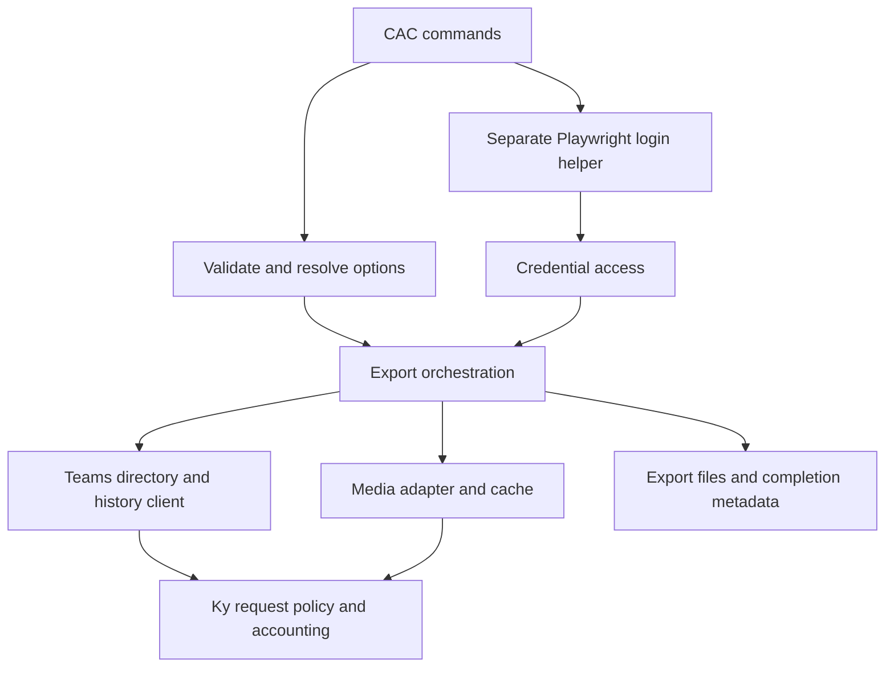

# CLI architecture plan

Plan date: **2026-11-04**. Status: **HTTP CLI and supported image exports implemented**. The [project README](../README.md) documents actual commands and current limitations. The [image reference](10-image-export.md) supersedes the media proposals below where implementation choices are now recorded: per-key cache metadata, sequential downloads, explicit refresh, portable local copies, partial status for unsupported references, and text publication before media with later retries from the saved archive.

This document records the stack agreed during architecture discussion and the recommended implementation structure. The [HTTP protocol reference](02-http-protocol.md) remains authoritative for observed Teams behavior. The [CLI design](04-cli-design.md) contains the user requirements and product proposals; the [validation plan](05-validation-and-open-questions.md) contains the detailed regression checks.

**Agreed direction** means a selected technology or requirement. **Implemented** defaults below describe the first slice; they can be revised as the product develops. **Proposed** decisions concern later behavior. Nothing here establishes a new Teams API capability.

## 1. Stack and reasons

| Concern                    | Selected direction                        | Reason                                                                               |
| -------------------------- | ----------------------------------------- | ------------------------------------------------------------------------------------ |
| Runtime and language       | Bun, strict TypeScript, ES modules        | Matches the user's experience and supports direct TypeScript execution               |
| CLI parsing                | CAC                                       | Fits a small set of commands, flags, and asynchronous actions                        |
| Runtime validation         | Zod                                       | Validates external input and derives the corresponding TypeScript types from schemas |
| HTTP                       | Ky over Bun's native Fetch implementation | Supplies configurable retries, timeouts, cancellation, and instrumentation points    |
| Tests                      | Bun's built-in `bun:test`                 | Tests run in the same runtime as the CLI                                             |
| Resumable collection       | Bun's built-in `bun:sqlite`               | Atomic message/coverage checkpoints and indexed JSON payloads without another dependency |
| Interactive authentication | Separate Playwright helper                | Browser interaction is needed for credential acquisition, not every export           |

Ordinary TypeScript execution does not replace static type checking or runtime payload validation. The dedicated `bun run typecheck` script invokes `tsc --noEmit`, independently of Zod's runtime checks and without requiring a newer Bun type-checking feature.

Use one package and direct imports/exports. Keep module boundaries as ordinary functions and explicit dependencies; no dependency-injection container or plugin framework is needed. A file-plus-JSON media index is the initial storage proposal, not an agreed database requirement.

The upstream references are [S19–S22](06-sources.md#9-application-stack). Registry stable versions were checked before installation. The first implementation used CAC **7.1.0**, Zod **4.6.7**, Ky **2.2.0**, TypeScript **7.0.2**, Bun types **1.4.4**, and Biome **2.6.5**. All dependencies now use caret (`^`) ranges in `package.json`, while `bun.lock` records exact resolved versions for reproducible installs. Type checking uses `tsc --noEmit`; runtime/tests were verified on Bun **1.3.14**. Recheck stable versions when changing dependencies.

## 2. Responsibilities and data flow

The diagram shows responsibilities, not separate processes or a mandatory file per box.

| Responsibility              | Owns                                                                                                               | Boundary                                                                                            |
| --------------------------- | ------------------------------------------------------------------------------------------------------------------ | --------------------------------------------------------------------------------------------------- |
| CLI                         | CAC command registration, help, asynchronous action dispatch, terminal reporting and exit status                   | Pass validated options to the application; do not expose CAC's permissive option types internally   |
| Input resolution            | Option schemas, mutually exclusive flags, date interpretation and one fixed window                                 | Produce typed options before making export requests                                                 |
| Export orchestration        | Coordinate one account, chat, window, cancellation signal, and run statistics                                      | Receive credentials and options; do not parse terminal arguments or launch login                    |
| Teams client                | Endpoint construction, response schemas, pagination, filtering, message identity and ordering                      | Preserve the protocol invariants; delegate transport and retries to HTTP                            |
| HTTP                        | Ky configuration, service-specific credentials and destinations, request attempts and retry reporting              | Do not decide date semantics, parse media references, or own the cache                              |
| Media                       | Resolve supported references, deduplicate logical media keys, reuse or download files                              | Cache lookup occurs before requesting media; bound concurrent downloads                             |
| Output                      | Source records, derived values, local media references and completion metadata                                     | Do not acquire credentials or hide failed retrieval behind a complete export                        |
| Credential access and login | Load typed credentials; acquire/refresh through the dedicated visible browser and verify before atomic publication | Dynamic import on `login` only; no browser on ordinary reads; unattended renewal remains unresolved |

A raw-ID export with explicit `--out` goes straight to that chat's history without a directory/profile lookup. Automatic naming uses a directory lookup when credentials are available; label selection always requires one to resolve the raw ID before history retrieval. Listing remains a distinct operation. History pages are fetched sequentially because continuation state depends on the preceding response. The Teams client starts the first history request immediately, then waits a random 2–5 seconds before each valid continuation by default. Export flags `--page-delay-min` and `--page-delay-max` configure this range in seconds. The wait is cancellable, adds no HTTP attempts, and sits outside the HTTP operation's timeout and retry policy; there is no pause after exhaustion. This pacing reduces request frequency without establishing Teams quotas or simulating browser interaction.

For tests, allow the request function and clock/wait behavior to be supplied where needed. These are small testing seams, not an abstraction over every library. Keep progress data structured until the CLI formats it. The CLI serves standalone terminal use: results, progress, save confirmations, and request/image summaries use `console.log()` on stdout; warnings use `console.warn()` and failures use `console.error()` on stderr. Stdout can mix JSON results with status text. Saved chat-list and export files provide JSON without terminal messages; exit codes indicate command success or failure.

## 3. Validation and source preservation

Validate at external boundaries: parsed CLI options, HTTP JSON, and persisted application metadata or credential state. Trusted internal calls use the resulting TypeScript types without repeatedly parsing the same object.

- **Teams JSON:** require the envelope and fields actually needed for retrieval, filtering, identity, and continuation. Model only shapes established by evidence or the supported adapter. An inventory of property names is not a complete schema.
- **Unknown Teams fields:** accept and preserve them. Use `z.looseObject()` at relevant object levels, or keep the source object separately from a validated projection. Ordinary `z.object()` strips unrecognized keys from its parsed output; one loose outer object does not preserve fields stripped by a nested schema.
- **Own inputs and metadata:** use explicit schemas, reject invalid combinations, and version persisted formats. The exact credential-file schema depends on the persistence decision.
- **Types:** derive boundary types with `z.infer` rather than maintaining a second handwritten interface for the same schema. Keep source fields distinct from derived timestamps, labels, and media paths.
- **Failures:** report the operation and invalid field path without dumping private values. Missing required fields must not become an empty message array, and invalid messages must not be silently skipped.

CAC validates argument syntax, but application semantics still need checking. Await asynchronous command execution using CAC's documented dispatch pattern so failures reach the CLI's error handler.

Ky supports `.json(schema)` with Standard Schema-compatible validators such as Zod. `.json<SomeType>()` alone supplies a static type, not runtime validation. Prefer the schema path when its parsed result preserves the source fields we need; retaining a separate source object can instead justify parsing unknown JSON and validating it explicitly. Choose one clear validation path per boundary.

## 4. HTTP policy with Ky

### 4.1 Service boundaries

Use shared transport policy with service-specific configuration. History uses `Authentication`, directory reads use `x-skypetoken`, and the verified image path uses the matching `skypetoken_asm` cookie. Do not merge these into one globally attached credential bundle.

Validate destinations before attaching credentials. Validate continuation URLs against the expected account/chat route and allowed service origins, preserve the original date bounds, and treat opaque cursors as opaque. Redirect handling must also enforce destination rules before forwarding custom credential headers. Explicitly handled redirects must pass through accounting; do not silently claim a client counter covers automatic redirect hops.

Keep the request templates and historical pagination correction in the [protocol reference](02-http-protocol.md#42-critical-rule-retain-the-original-date-bounds). Do not copy a returned `backwardLink` unchanged and lose `endTime`.

### 4.2 Retries, deadlines, and cancellation

Ky owns the retry mechanism. Teams methods, export orchestration, and media workers must not add independent retry loops around it. Any deliberate recovery request, such as fetching a missing local body after a `304`, is a separate counted request with a bounded recovery path.

Configure retryable read failures, attempt limits, backoff, timeouts, and cancellation explicitly. Ky v2.2.0 defaults to two retries; accepting defaults silently would allow more calls than one logical operation suggests. Exact client limits remain implementation decisions, not known Teams quotas.

Honor applicable `Retry-After` guidance. If the indicated wait exceeds the permitted waiting budget, stop with an explicit retryable failure rather than sending the next request early. In the reviewed Ky version, `maxRetryAfter` clamps the delay, so setting a smaller value is not a substitute for this policy. A total deadline may cancel the operation before another attempt.

Do not repeatedly retry unchanged authentication rejections, interaction requirements, or schema failures. Cancellation must prevent additional attempts and media scheduling. Retain completed media on failure and report truthful partial progress. Never convert transport, HTTP, or schema errors into successful empty history.

### 4.3 Accounting

Wrap Ky's underlying `fetch` to count actual transport invocations, including failures and retries. Ky's `beforeRequest` hook runs once before retry handling, so it is insufficient as the sole attempt counter. Cache hits must bypass the HTTP client altogether.

Use purpose-specific counts for history, directory, media, and authentication/other requests. Retry attempts are a subset of the total. Observe retry dispatch at the transport boundary; a retry hook that runs before a subsequent cancellation must not be counted as a sent attempt. Successfully processed pages and completed downloads are separate counters.

Browser login traffic remains outside ordinary export counters unless separately instrumented. Keep the scope explicit and avoid logging credential-bearing URLs or raw errors containing private response bodies. See the full [accounting requirements](04-cli-design.md#62-request-accounting).

### 4.4 Media refresh

A complete matching cached file is reused with zero network requests by default. Explicit refresh may use a conditional request, which still counts as an attempt.

Ky normally treats non-2xx statuses as errors. The media refresh path must deliberately accept and handle `304` while preserving normal handling of actual failures. Do not disable HTTP error handling globally just to accept `304`; that would also change status-based retry behavior.

On `304`, reuse a complete local body. If the body is missing, make a bounded unconditional recovery request. On `200`, validate the completed download before replacing the existing entry. Never parse a `304` as a JSON response or write its empty body over a cached image.

## 5. Storage and output boundaries

| Data                            | Location and ownership                                                                      | Policy                                                                                                  |
| ------------------------------- | ------------------------------------------------------------------------------------------- | ------------------------------------------------------------------------------------------------------- |
| Credentials and browser profile | Private account-scoped state, separate from exports and source control                      | Backend, exact paths, permissions, profile ownership and renewal flow still need a decision             |
| Shared media cache              | Persistent account-scoped files plus a metadata index, initially proposed as JSON           | Key by service/namespace, object, representation and available version; reuse across export directories |
| Export                          | Canonical JSON at an automatic or user-selected destination, with optional derived Markdown | Snapshots refuse overwrite; default daily exports refresh verified archives with individually atomic writes             |

The cache is independent of one export. Re-fetch text for the requested window; do not introduce a persistent message-range cache initially. Deduplicate media references within the run before scheduling downloads.

Download to temporary files, validate, then promote complete entries. Publish metadata only after the corresponding file is available. Start with a simple storage model; a shared JSON index needs an explicit single-writer constraint or safe coordination before concurrent CLI processes are supported. Exact locking and metadata layout need not be designed before choosing that support scope.

Retain useful source fields and keep derived output separate. Raw messages remain private data even when credentials are excluded. JSON is the canonical saved output; Markdown is derived from that saved file, so a renderer failure does not discard successfully retrieved history. HTML and local media rendering remain future work. File output must distinguish interrupted work from complete results and avoid accidentally overwriting a previous export.

`src/archive.ts` owns the shared source-message schema and the version 1 archive reader. It validates the version, completion status, fields consumed by renderers, and window membership while retaining additive fields. `src/markdown.ts` renders the parsed archive using Turndown 7.2.5, with literal text escaping, executable-element removal, safe-link handling, and explicit unavailable-media placeholders. It imports no HTTP or credential code. `src/convert.ts` reads an existing archive and publishes Markdown through the same private, atomic, no-overwrite writer as history JSON. Both `convert` and new `export` bundles use this path; export saves JSON before starting conversion. Default daily refreshes use the same renderer and atomic replacement writers to update existing JSON and Markdown. Markdown-skipped exports retain their existing manifest and JSON result fields; terminal summaries accompany those results on stdout. Additional formats should follow this saved-archive boundary rather than adding API calls to renderers.

Markdown presentation groups messages under local calendar dates and compact speaker turns. Consecutive chat messages share a turn only when their source sender identity and displayed name match and the gap is at most five minutes. Day boundaries, sender changes, longer gaps, system events, and a local clock rollback break turns; unknown sender identities do not group. Bodies remain separate blocks. The system timezone (or `TZ` override) is labeled once; time labels use 24-hour minutes or a turn's start–end range. Message IDs and technical types stay in JSON. This corrects the initial Markdown renderer's per-record layout, which repeated full ISO timestamps and metadata for every message and made conversations difficult to read.

`src/convert-all.ts` adds sequential offline directory conversion through `convert-all`, defaulting to `exports/` with explicit `--dir` and optional `--recursive`. It uses `src/export-discovery.ts` to visit regular JSON files in the selected directory, legacy direct export-folder `chat.json`, and standard `<chat>/<date-or-period>/chat.json` bundles, without following symlink entries or descending into media/deeper folders and skips any existing sibling Markdown destination before parsing the source. Each remaining file goes through `convertArchive`, preserving the single-file validation and publication contract. Per-file errors are collected alongside converted/skipped counts, and the CLI exits unsuccessfully if any file fails. Scan failures and cancellation stop the batch; files already published remain available. The batch never overwrites existing Markdown or changes source JSON.

`src/archive-media.ts` coordinates media updates from saved JSON for both `export` and `media --input`. Export now publishes JSON and its default Markdown before entering this phase. The media command reads the archive rather than fetching history, checks the account and request counters, and holds an exclusive adjacent lock while updating. Completed images use content-based paths and survive failure, so an interrupted refresh preserves the previous manifest's image bytes. Only a successful media pass replaces the manifest, then regenerates sibling Markdown unless skipped. Replacements are individually atomic; a Markdown failure retains the updated JSON for a cached retry. Initial snapshot publication and offline conversion retain their no-overwrite contract. Default `--last 1d` exports use `exports/<chat>/<local-date>/` and hold the same `withArchiveLock` reservation across history retrieval, text replacement, and media work; the locked media core avoids reacquiring that reservation. Existing daily archives must match the account, raw chat ID, and start bound, with an endpoint no newer than the invocation. Symlink destinations are rejected. A failed history fetch preserves the saved bundle; after JSON publication, a later Markdown/media failure keeps the new JSON. A daily refresh with `--no-markdown` removes the stale transcript; old unreferenced images are retained. Other windows remain timestamped snapshots under the chat folder, explicit `--out` remains protected, and old exports are not migrated. The image reference documents lock recovery, retained old files, and request-count scope.

`src/collect.ts` adds backward resumable collection using the same history reader. `src/history-store.ts` binds one SQLite file to one account, stores full message JSON with indexed IDs/times, subtracts complete coverage, and atomically commits exhausted windows. Windows start at seven days and expand only after empty results; no saved cursor or cross-page timestamp ordering is assumed. `src/database-export.ts` reads a complete covered range offline and publishes the existing version 1 JSON/Markdown bundle; media bytes remain the normal saved-archive workflow. See [SQLite collection](11-sqlite-collection.md) for schema, locking, failure semantics, and analytics projections.

## 6. First implementation milestone

**Implemented after user authorization:** bounded history export by supplied chat ID, private credential JSON with automatic lookup, and one JSON output document with source messages and run metadata. `chats` lists IDs and available titles, resolves untitled one-to-one names through self and batch profile reads, and caches names for 24 hours. Explicit unresolved fallbacks remain for missing credentials or unavailable/ambiguous members. Partial directories and profile HTTP failures fail explicitly. `login` now owns visible persistent-browser capture, HTTP verification, and atomic credential publication. Media caching and unattended renewal remain subsequent milestones.

`src/profiles.ts` owns profile URL/query schemas, self-MRI exclusion, routing personal and organization counterparts, and an atomic private JSON name cache. The cache is credential-scoped and stores only MRI/name pairs, self identity, fetch time, version, and scope digest. `--refresh-names` bypasses it. Only the verified read-only profile POSTs use the HTTP client's JSON-body path and POST retry policy; profile attempts have their own counter. Automatic naming for raw-ID exports reads the directory and resolves only the selected chat's label, reusing this name cache. An explicit `--out` skips directory and participant lookups for raw-ID selection. `--chat-label` instead resolves the current directory's labels to a unique exact match after trimming surrounding whitespace and ignoring case, even with `--out`; it reuses that label for naming without another directory lookup. Missing, ambiguous, and generic labels cannot start history retrieval. The archive retains the resolved raw ID. Saved chat lists remain explicit snapshots from `chats --out`, with no automatic list persistence or selection from saved lists. See the [full profile contract](08-participant-profiles.md).

The first slice uses these revisable defaults:

| Decision             | Recommended starting point                                                                                                                                                                                                 | Current status                                                                                                                                                         |
| -------------------- | -------------------------------------------------------------------------------------------------------------------------------------------------------------------------------------------------------------------------- | ---------------------------------------------------------------------------------------------------------------------------------------------------------------------- |
| Credential input     | Optional `--credentials` override; otherwise per-user state JSON, then installation-local `.private/credentials.json` when the state file is missing                                                                       | Implemented; `login` writes verified state with a stable self-MRI-derived account label; Unix group/other permissions rejected; no unattended renewal                  |
| Date semantics       | Half-open UTC millisecond window; full timestamps require `Z` or an offset; `--last Nd` starts at local midnight N−1 calendar days ago and ends at invocation time                                                         | Implemented with Day.js; local timezone or `TZ` override; date-only and submillisecond inputs rejected                                                                 |
| Filtering timestamp  | `originalarrivaltime`, preserving the other source timestamps                                                                                                                                                              | Implemented; unexpected out-of-window responses fail                                                                                                                   |
| Output               | Canonical JSON with a versioned manifest, automatic label/period directory under `exports/` or explicit `--out <directory>`, containing `chat.json`, optional `chat.md`, and `media/`, optional Markdown; protected snapshots and default daily refreshes | Implemented; Markdown reads the saved JSON and is also available through offline `convert`; conversion failure retains JSON; no partial history file or durable resume |
| Initial scope        | Supplied chat ID or unique resolved label, plus directory listing and browser-assisted credentials                                                                                                                         | Implemented; retrieval holds the selected window in memory; images remain future work                                                                                  |
| Operational settings | Two retries, 15-second per-attempt timeout, 60-second per-operation deadline                                                                                                                                               | Implemented; redirects refused, counters at Fetch boundary; media concurrency still future work                                                                        |

These defaults are not planning gates for later changes. Conflicting duplicate records fail explicitly until revision selection is established; identical duplicate records are removed. Output files use mode `0600`, and new parent directories use mode `0700`.

## 7. Acceptance and next stages

The first milestone should meet these criteria using synthetic responses before a small ordinary live export:

1. Invalid or conflicting options fail before export traffic; valid options resolve one fixed window.
2. A historical first request needs no latest-history traversal or cursor. Continuations retain both bounds and are destination-checked.
3. Out-of-order records and duplicate IDs produce deterministic results under an explicit identity/version policy. Service-reported exhaustion is recorded without claiming independent archival completeness.
4. Additive response fields survive; incompatible required fields fail visibly. Unknown message types are preserved even if not rendered.
5. Controlled `429`/transient failures, cancellation, and retry exhaustion enforce policy without live rate-limit probing. No attempt occurs earlier than applicable server guidance permits.
6. Counters include retries and transport failures once and distinguish received pages from attempts. Redirect and browser-traffic scope is explicit.
7. A failed later page or write cannot be reported as a complete export. Diagnostics and manifests exclude credentials and raw cursors.
8. Type checking and the relevant `bun:test` suite pass. The first ordinary Bun/Ky live check listed 15 chats and exported 5 messages with one request each (E17). The browser remained open; repeat with the browser closed and validate live multi-page CLI traversal before claiming those cases are verified.

When media is added, require zero-request cache hits across overlapping exports, one download per uncached logical key, correct representation separation, bounded concurrency, interruption-safe cache promotion, and deliberate `304` recovery. Prove the raw-reference-to-URL adapter before claiming image coverage.

Credential lookup uses `$XDG_STATE_HOME/teams-chat-download/credentials.json`, defaulting to `~/.local/state/teams-chat-download/credentials.json` when XDG state home is unset, empty, or relative. The compatibility fallback is anchored to the installation rather than the working directory. An explicit path disables fallback; malformed, unreadable, or unsafe files always fail without switching accounts. Lookup does not create, migrate, capture, or renew credentials. See the [setup and lookup order](../README.md#setup).

The [login implementation](09-browser-login.md) uses lazily imported `playwright-core` 1.64.1, an installed Chromium executable, sandboxed visible mode, and native Wayland when present. E20 verifies two login runs plus a listing/export after the login browser closes. It does not attach to MCP, migrate profiles, collect media cookies, or promise unattended renewal. Only the login command imports the browser module.

The detailed behavior checks remain in [validation sections 9.1–9.5](05-validation-and-open-questions.md#9-regression-checks-for-future-implementation). The implemented synthetic suite covers history, directory, request policy, dates, credentials, and output publication; media checks remain future work. This plan does not by itself authorize unrelated scope or global configuration changes.

## Command configuration ownership

`src/cli.ts` owns CAC flag declarations, argument parsing, command dispatch, and terminal output for the exporter commands. `src/live-smoke.ts` owns the separate opt-in smoke CLI. `src/command-validation.ts` owns the schemas and option resolution for both, including cross-option checks, date-window calculation, and login browser/path discovery. Schema constants use the `Schema` suffix; command data types retain names such as `ExportOptions`.

`src/config.ts` is the authoritative source for shared command defaults and limits: page delays, login timeout, export root, output format, and default command toggles. Validation applies these defaults, help descriptions interpolate displayed values, and runtime fallbacks import the same definitions. This is an internal defaults module, not a new user configuration file or configuration precedence layer. Environment-dependent paths remain resolved at invocation time by existing helpers; protocol constants remain local to their domain modules.

`src/date-window.ts` owns the shared window type and validity checks. The Teams history client imports that contract and paging defaults directly, and declares its own paging inputs without depending on export command types. Command validation imports no browser automation implementation; the login command loads that implementation lazily.

## Bounded live smoke test

`bun run test:live` runs `src/live-smoke.ts` separately from the offline Bun test suite. It needs no selector: `src/smoke-targets.ts` automatically discovers a complete same-account archive beneath the configured default export root in the current working directory. It uses shared bounded discovery to examine regular root JSON files, legacy direct export-folder `chat.json`, and standard `<chat>/<date-or-period>/chat.json` bundles, ignoring symlinks, media directories, and deeper descendants. Candidates are ordered by modification time (newest first), then deterministic path order; archives with more useful known sender/image inputs are preferred. Invalid/unreadable candidates are skipped with a count, while other accounts are ignored. Discovery is local and read only, and the selected path is printed.

At most one of `--fixture <chat.json>`, `--chat`, or `--chat-label` overrides automatic history-target selection. An explicit fixture bypasses discovery, must be a complete version 1 archive accepted by `readArchive`, and requires an exact `accountId` match; malformed or mismatched explicit fixtures fail before HTTP rather than silently falling back. A fixture supplies the raw chat ID, supported sender identity, and supported inline image reference independently of live discovery. The original archive and its media are never updated or counted as live responses. Without any fixture or selector, a successful live directory can supply its first chat as the history target; unavailable inputs remain unverified rather than preventing independent probes.

Without date arguments, the live window defaults to the last two local calendar days including today, matching `export --last 2d`: yesterday at local midnight through one captured invocation time. This default is retained in fixture mode; the archived window is not substituted. `src/config.ts` owns `defaultLiveSmokeDays`; both smoke and export validation use the same calendar-day calculation, respecting the system timezone, `TZ`, and daylight-saving transitions. Both explicit `--from` and `--to` are required to override the default window; single bounds are rejected.

`resolveLiveSmokeOptions` validates selector exclusivity, timezone-qualified millisecond-precision explicit bounds, ordering, and a non-future end before credentials are loaded. The runner prints the resolved inclusive start and exclusive end before making requests and never widens them automatically. A quiet default window can leave pagination or media unverified; an explicit busier historical window remains available. Normal credential lookup and the optional `--credentials` override are reused. There is no browser automation or automatic credential renewal.

`src/chat-selection.ts` owns the shared label matcher used by both export and smoke selection: exact matching after trimming and case folding, generic fallback rejection, and missing/duplicate diagnostics. Label-mode smoke checks resolve all needed one-to-one names from the already-fetched directory, so duplicate matches across group titles and participant names cannot be missed. No second directory request is made. Explicit labels retain their live discovery dependencies; filenames never become guessed label mappings. Explicit history selections take precedence over discovered archive chat IDs. Automatic fixtures can still supply participant and media inputs from the same account when an explicit history selector is used, including when label resolution fails. Default no-selector, explicit fixture, and raw-ID history probes have no directory-membership veto.

`teams.ts` exposes `readChatDirectory` for a validated directory with member identities and `readHistoryPages` as an async iterator of validated new records per page. Existing `listChats` still resolves names through `resolveChatNames`; existing `readHistory` exhausts the iterator and sorts the complete deduplicated result. The smoke runner breaks iteration after two pages, retaining all existing request/authentication, date-bound, cursor, progress, duplicate, revision, cancellation, and pacing checks. It never represents this sample as an exhausted archive.

`profiles.ts` exposes `readSelfProfile` and `readParticipantProfiles` as direct HTTP/schema primitives, plus `chatCounterpart` and `labelChats` for shared label semantics. The existing cached `resolveChatNames` uses these same functions and retains its 24-hour cache policy. Smoke probes call the direct primitives without any name-cache reuse: the self request always runs independently of directory success, and the participant request uses one known non-self sender from the fixture or directory members. Label mode instead resolves all required counterparts with the same batch routes and pure labeling function, reusing the self-profile result rather than requesting it again.

`smoke-targets.ts` owns shared fixture input extraction. Supported sender inputs are raw `8:live:`/`8:orgid:` identities or HTTPS `/v1/users/ME/contacts/{mri}` links; those source URLs are never fetched. A successful self response excludes the account's own identity; login-generated SHA-256 account IDs also allow that exclusion when the self request fails. Legacy custom account labels require a self result to distinguish another participant, otherwise participant coverage remains unverified. Missing or unsupported sender shapes cannot silently become guessed profile targets.

History first-page and pagination checks advance the same iterator separately. A continuation failure fails pagination while preserving the verified first-page result. At most two pages are consumed, and the iterator is closed during cleanup. Media selects at most one supported image, preferring the fixture's reference and falling back to validated sampled history if necessary; directory/history failures and quiet live windows do not block a known fixture image. `downloadImages` performs a cold live GET into private temporary media storage, then local reuse and conditional revalidation. A `finally` block removes temporary files on handled completion, failure, and cancellation. Abrupt termination can leave temporary files. Existing fixtures, credentials, exports, and ordinary caches are never modified.

A successful representative fixture/raw-ID run normally uses seven attempts before retries: one directory, two profile, two history, and two media. Eight checks report directory, self profile, participant profiles, first-page history, pagination, media cookie, cache reuse, and media revalidation separately. Label selection may require additional profile batches. Remaining dependencies are explicit: pagination needs a first page/cursor; cache/revalidation need cold bytes and applicable validators. HTTP 304 exercises validated cached-byte reuse; a valid conditional HTTP 200 exercises refreshed-image fallback and explicitly leaves the 304 branch unverified. Missing validators are reported unverified without another unconditional image download. Normal HTTP timeouts, retry limits, origin isolation, redirect refusal, and request counters remain in force.

Checks print `PASS`, `FAIL`, or `UNVERIFIED` without credentials, message bodies, or source URLs. Missing continuation, participant, image, or conditional validator cannot silently count as success. All required checks must pass for exit 0; failure, unverified coverage, invalid invocation, or cancellation exits 1. Independent checks continue after a service failure, while dependent checks report unverified. This probes the selected history window, participant profile family, and image origin; it does not test all routes/origins, browser capture, full-history exhaustion, archive persistence, or Markdown conversion.

`tests/live-smoke.test.ts` injects only synthetic HTTP responses into the production clients to verify budgets, authentication isolation, fixed pagination bounds, cold versus warm cache behavior, conditional refresh, honest missing coverage, service-failure independence, automatic/explicit target precedence, fixture validation/immutability, and cancellation. `tests/smoke-targets.test.ts` verifies discovery preference, account isolation, invalid-candidate reporting, shallow filesystem scope, symlink handling, and cancellation. The ordinary test suite never makes live requests.
