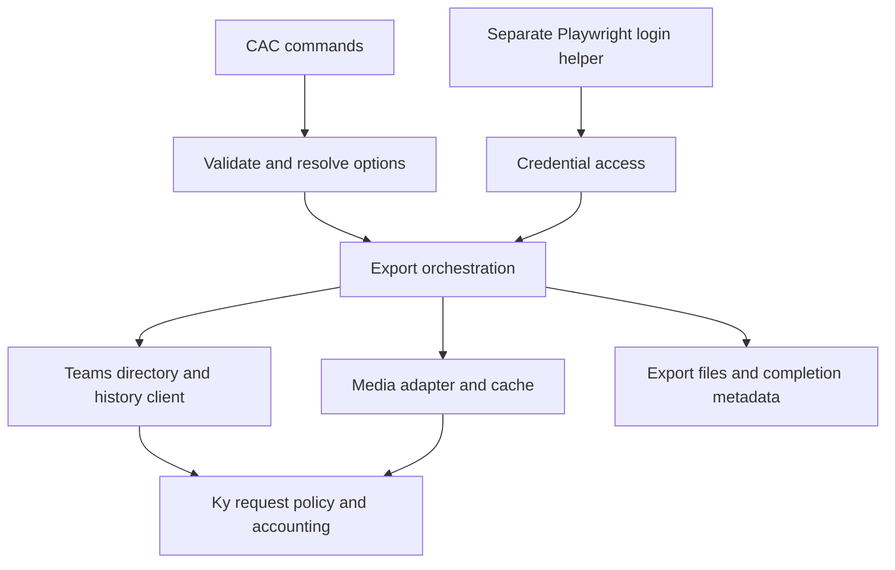

# CLI architecture plan

Plan date: **2026-11-04**. Status: **documentation only; no application code exists**.

This document records the stack agreed during architecture discussion and the recommended implementation structure. The [HTTP protocol reference](02-http-protocol.md) remains authoritative for observed Teams behavior. The [CLI design](04-cli-design.md) contains the user requirements and product proposals; the [validation plan](05-validation-and-open-questions.md) contains the detailed regression checks.

**Agreed direction** means a selected technology or requirement, not a working implementation. **Proposed** decisions below still need to be settled before implementing the affected behavior. Nothing here establishes a new Teams API capability.

## 1. Stack and reasons

| Concern | Selected direction | Reason |
| --- | --- | --- |
| Runtime and language | Bun, strict TypeScript, ES modules | Matches the user's experience and supports direct TypeScript execution |
| CLI parsing | CAC | Fits a small set of commands, flags, and asynchronous actions |
| Runtime validation | Zod | Validates external input and derives the corresponding TypeScript types from schemas |
| HTTP | Ky over Bun's native Fetch implementation | Supplies configurable retries, timeouts, cancellation, and instrumentation points |
| Tests | Bun's built-in `bun:test` | Tests run in the same runtime as the CLI |
| Interactive authentication | Separate Playwright helper | Browser interaction is needed for credential acquisition, not every export |

Ordinary TypeScript execution does not replace static type checking or runtime payload validation. Provide a dedicated `typecheck` script, invoked through `bun run typecheck`. Select its backing checker and compatible development dependencies when scaffolding; do not assume a newer Bun feature is available on the installed runtime.

Use one package and direct imports/exports. Keep module boundaries as ordinary functions and explicit dependencies; no dependency-injection container or plugin framework is needed. A file-plus-JSON media index is the initial storage proposal, not an agreed database requirement.

The upstream references are [S19–S22](06-sources.md#9-application-stack). Ky behavior was reviewed against **v2.2.0**, not assumed from the development branch. This is a reviewed version, not a dependency pin or a claim about the npm distribution tag. Before installing, verify current stable versions, select compatible versions, and commit the resulting Bun lockfile. No packages were installed during this planning task.

## 2. Responsibilities and data flow

The diagram shows responsibilities, not separate processes or a mandatory file per box.

| Responsibility | Owns | Boundary |
| --- | --- | --- |
| CLI | CAC command registration, help, asynchronous action dispatch, terminal reporting and exit status | Pass validated options to the application; do not expose CAC's permissive option types internally |
| Input resolution | Option schemas, mutually exclusive flags, date interpretation and one fixed window | Produce typed options before making export requests |
| Export orchestration | Coordinate one account, chat, window, cancellation signal, and run statistics | Receive credentials and options; do not parse terminal arguments or launch login |
| Teams client | Endpoint construction, response schemas, pagination, filtering, message identity and ordering | Preserve the protocol invariants; delegate transport and retries to HTTP |
| HTTP | Ky configuration, service-specific credentials and destinations, request attempts and retry reporting | Do not decide date semantics, parse media references, or own the cache |
| Media | Resolve supported references, deduplicate logical media keys, reuse or download files | Cache lookup occurs before requesting media; bound concurrent downloads |
| Output | Source records, derived values, local media references and completion metadata | Do not acquire credentials or hide failed retrieval behind a complete export |
| Credential access and login | Load a typed credential set; separately acquire or renew it through the selected browser workflow | No browser launch as an import side effect; persistence and renewal remain unresolved |

An export with a supplied chat ID goes straight to that chat's history; it does not require a directory lookup for a display label. Listing remains a distinct operation. History pages are fetched sequentially because continuation state depends on the preceding response.

For tests, allow the request function and clock/wait behavior to be supplied where needed. These are small testing seams, not an abstraction over every library. Keep progress data structured until the CLI formats it; send diagnostics to stderr so machine-readable stdout can remain usable.

## 3. Validation and source preservation

Validate at external boundaries: parsed CLI options, HTTP JSON, and persisted application metadata or credential state. Trusted internal calls use the resulting TypeScript types without repeatedly parsing the same object.

- **Teams JSON:** require the envelope and fields actually needed for retrieval, filtering, identity, and continuation. Model only shapes established by evidence or the supported adapter. An inventory of property names is not a complete schema.
- **Unknown Teams fields:** accept and preserve them. Use `z.looseObject()` at relevant object levels, or keep the source object separately from a validated projection. Ordinary `z.object()` strips unrecognized keys from its parsed output; one loose outer object does not preserve fields stripped by a nested schema.
- **Own inputs and metadata:** use explicit schemas, reject invalid combinations, and version persisted formats. The exact credential-file schema depends on the persistence decision.
- **Types:** derive boundary types with `z.infer` rather than maintaining a second handwritten interface for the same schema. Keep source fields distinct from derived timestamps, labels, and media paths.
- **Failures:** report the operation and invalid field path without dumping private values. Missing required fields must not become an empty message array, and invalid messages must not be silently skipped.

CAC validates argument syntax, but application semantics still need checking. Await asynchronous command execution using CAC's documented dispatch pattern so failures reach the CLI's error handler.

Ky supports `.json(schema)` with Standard Schema-compatible validators such as Zod. `.json<SomeType>()` alone supplies a static type, not runtime validation. Prefer the schema path when its parsed result preserves the source fields we need; retaining a separate source object can instead justify parsing unknown JSON and validating it explicitly. Choose one clear validation path per boundary.

## 4. HTTP policy with Ky

### 4.1 Service boundaries

Use shared transport policy with service-specific configuration. History uses `Authentication`, directory reads use `x-skypetoken`, and the verified image path uses the matching `skypetoken_asm` cookie. Do not merge these into one globally attached credential bundle.

Validate destinations before attaching credentials. Validate continuation URLs against the expected account/chat route and allowed service origins, preserve the original date bounds, and treat opaque cursors as opaque. Redirect handling must also enforce destination rules before forwarding custom credential headers. Explicitly handled redirects must pass through accounting; do not silently claim a client counter covers automatic redirect hops.

Keep the request templates and historical pagination correction in the [protocol reference](02-http-protocol.md#42-critical-rule-retain-the-original-date-bounds). Do not copy a returned `backwardLink` unchanged and lose `endTime`.

### 4.2 Retries, deadlines, and cancellation

Ky owns the retry mechanism. Teams methods, export orchestration, and media workers must not add independent retry loops around it. Any deliberate recovery request, such as fetching a missing local body after a `304`, is a separate counted request with a bounded recovery path.

Configure retryable read failures, attempt limits, backoff, timeouts, and cancellation explicitly. Ky v2.2.0 defaults to two retries; accepting defaults silently would allow more calls than one logical operation suggests. Exact client limits remain implementation decisions, not known Teams quotas.

Honor applicable `Retry-After` guidance. If the indicated wait exceeds the permitted waiting budget, stop with an explicit retryable failure rather than sending the next request early. In the reviewed Ky version, `maxRetryAfter` clamps the delay, so setting a smaller value is not a substitute for this policy. A total deadline may cancel the operation before another attempt.

Do not repeatedly retry unchanged authentication rejections, interaction requirements, or schema failures. Cancellation must prevent additional attempts and media scheduling. Retain completed media on failure and report truthful partial progress. Never convert transport, HTTP, or schema errors into successful empty history.

### 4.3 Accounting

Wrap Ky's underlying `fetch` to count actual transport invocations, including failures and retries. Ky's `beforeRequest` hook runs once before retry handling, so it is insufficient as the sole attempt counter. Cache hits must bypass the HTTP client altogether.

Use purpose-specific counts for history, directory, media, and authentication/other requests. Retry attempts are a subset of the total. Observe retry dispatch at the transport boundary; a retry hook that runs before a subsequent cancellation must not be counted as a sent attempt. Successfully processed pages and completed downloads are separate counters.

Browser login traffic remains outside ordinary export counters unless separately instrumented. Keep the scope explicit and avoid logging credential-bearing URLs or raw errors containing private response bodies. See the full [accounting requirements](04-cli-design.md#62-request-accounting).

### 4.4 Media refresh

A complete matching cached file is reused with zero network requests by default. Explicit refresh may use a conditional request, which still counts as an attempt.

Ky normally treats non-2xx statuses as errors. The media refresh path must deliberately accept and handle `304` while preserving normal handling of actual failures. Do not disable HTTP error handling globally just to accept `304`; that would also change status-based retry behavior.

On `304`, reuse a complete local body. If the body is missing, make a bounded unconditional recovery request. On `200`, validate the completed download before replacing the existing entry. Never parse a `304` as a JSON response or write its empty body over a cached image.

## 5. Storage and output boundaries

| Data | Location and ownership | Policy |
| --- | --- | --- |
| Credentials and browser profile | Private account-scoped state, separate from exports and source control | Backend, exact paths, permissions, profile ownership and renewal flow still need a decision |
| Shared media cache | Persistent account-scoped files plus a metadata index, initially proposed as JSON | Key by service/namespace, object, representation and available version; reuse across export directories |
| Export | A user-selected destination with source messages, completion metadata and included media | Portable local references; output format, layout and overwrite rules remain proposed |

The cache is independent of one export. Re-fetch text for the requested window; do not introduce a persistent message-range cache initially. Deduplicate media references within the run before scheduling downloads.

Download to temporary files, validate, then promote complete entries. Publish metadata only after the corresponding file is available. Start with a simple storage model; a shared JSON index needs an explicit single-writer constraint or safe coordination before concurrent CLI processes are supported. Exact locking and metadata layout need not be designed before choosing that support scope.

Retain useful source fields and keep derived output separate. Raw messages remain private data even when credentials are excluded. JSON is the recommended first output; HTML/Markdown rendering and sanitization can follow once their scope is selected. File output must distinguish interrupted work from complete results and avoid accidentally overwriting a previous export.

## 6. Proposed first implementation milestone

**Recommendation, not yet approved scope:** one bounded text export by supplied chat ID, using explicitly supplied credentials and producing JSON plus run metadata. Add the media adapter/cache and browser login helper as subsequent milestones. This exercises the difficult pagination and request policy without first requiring complete name lookup or browser renewal.

Before implementing that milestone, settle:

| Decision | Recommended starting point | Current status |
| --- | --- | --- |
| Credential input | A validated, explicit private credential source; keep secret values out of command-line arguments | Backend and input interface unresolved |
| Date semantics | Half-open UTC millisecond window; full timestamps require `Z` or an offset; `--last 7d` is 168 hours | Proposed; date-only values can be deferred rather than guessed |
| Filtering timestamp | `originalarrivaltime`, preserving the other source timestamps | Proposed from the measured behavior |
| Output | JSON with a versioned manifest, explicit destination, and no overwrite by default | Proposed; final layout and partial-output handling unresolved |
| Initial scope | Supplied chat ID and explicit re-login when needed | Proposed; does not remove later chat listing, images, or login requirements |
| Operational settings | Explicit finite retry/deadline settings; small bounded media concurrency when images are added | Values to choose and test during implementation |

These decisions are sufficient to start a focused milestone; they do not require a complete design for every later renderer or renewal mechanism.

## 7. Acceptance and next stages

The first milestone should meet these criteria using synthetic responses before a small ordinary live export:

1. Invalid or conflicting options fail before export traffic; valid options resolve one fixed window.
2. A historical first request needs no latest-history traversal or cursor. Continuations retain both bounds and are destination-checked.
3. Out-of-order records and duplicate IDs produce deterministic results under an explicit identity/version policy. Service-reported exhaustion is recorded without claiming independent archival completeness.
4. Additive response fields survive; incompatible required fields fail visibly. Unknown message types are preserved even if not rendered.
5. Controlled `429`/transient failures, cancellation, and retry exhaustion enforce policy without live rate-limit probing. No attempt occurs earlier than applicable server guidance permits.
6. Counters include retries and transport failures once and distinguish received pages from attempts. Redirect and browser-traffic scope is explicit.
7. A failed later page or write cannot be reported as a complete export. Diagnostics and manifests exclude credentials and raw cursors.
8. Type checking and the relevant `bun:test` suite pass. A small ordinary live check then confirms the selected Bun/Ky versions and supplied credentials work without a running browser; that remains unverified today.

When media is added, require zero-request cache hits across overlapping exports, one download per uncached logical key, correct representation separation, bounded concurrency, interruption-safe cache promotion, and deliberate `304` recovery. Prove the raw-reference-to-URL adapter before claiming image coverage.

When login is added, select its standalone interface and credential backend, preserve the working platform setup, and demonstrate a cold-start export. Do not assume MCP or CLI attachment, token renewal, or browser-profile portability has already been implemented.

The detailed behavior checks remain in [validation sections 9.1–9.5](05-validation-and-open-questions.md#9-regression-checks-for-future-implementation). Use small synthetic fixtures and a controlled transport/clock for failure tests. This architecture plan does not authorize scaffolding, package installation, global configuration changes, or application implementation on its own.
